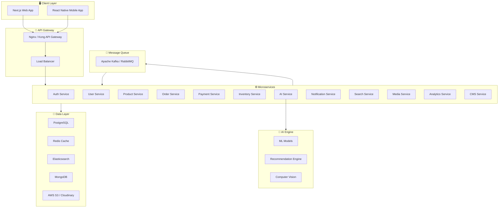
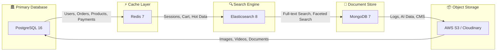
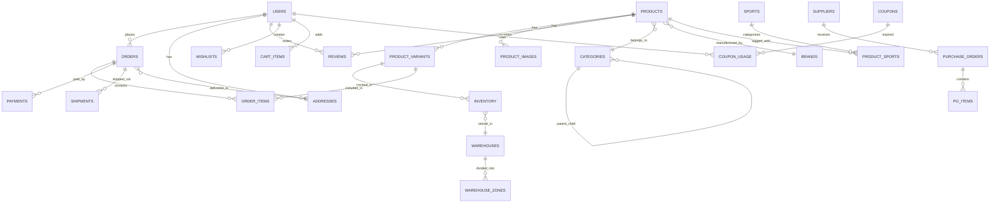
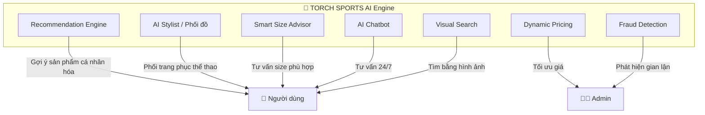
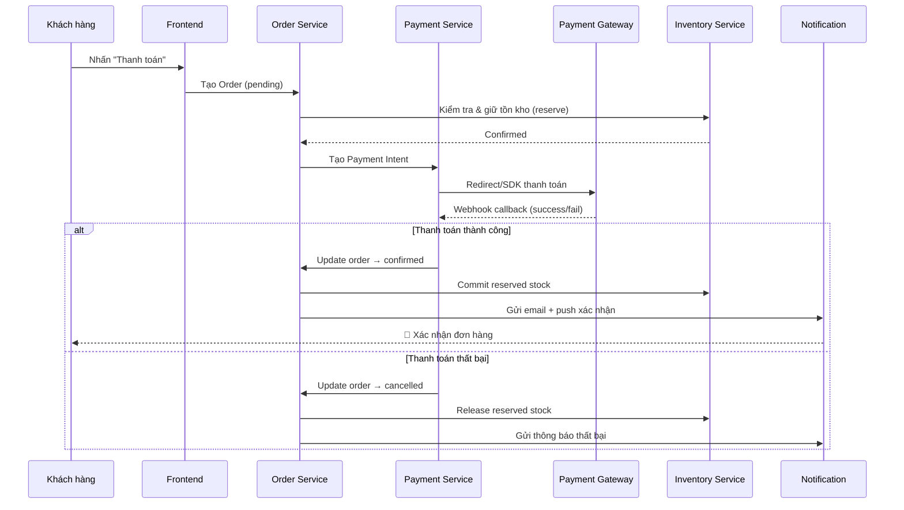
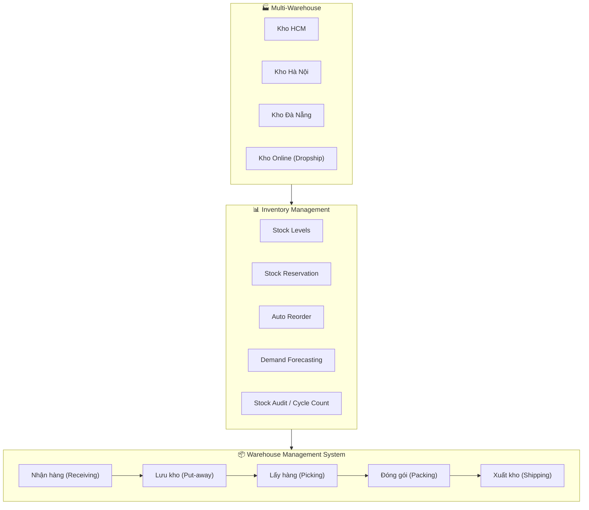
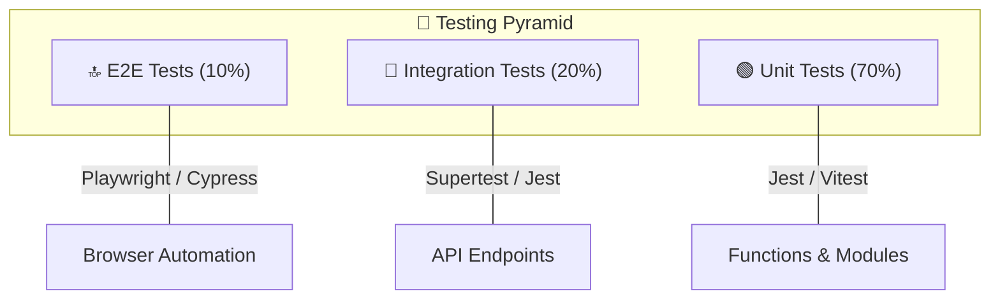

# 🔥 TORCH SPORTS — Master Plan

> **Nền tảng thương mại điện tử dụng cụ & trang phục thể thao tích hợp AI**
> Repository: [torch-sports](https://github.com/nguyenthehieu0109/torch-sports) (Private)

---

## Mục lục

1. [Tổng quan dự án](#1-tổng-quan-dự-án)
2. [Kiến trúc hệ thống](#2-kiến-trúc-hệ-thống)
3. [Công nghệ & Ngôn ngữ](#3-công-nghệ--ngôn-ngữ)
4. [Cơ sở dữ liệu](#4-cơ-sở-dữ-liệu)
5. [Chi tiết các Module](#5-chi-tiết-các-module)
6. [Tích hợp AI](#6-tích-hợp-ai)
7. [Thanh toán trực tuyến](#7-thanh-toán-trực-tuyến)
8. [Quản lý kho bãi & hàng tồn](#8-quản-lý-kho-bãi--hàng-tồn)
9. [Ứng dụng di động (App)](#9-ứng-dụng-di-động-app)
10. [Hạ tầng & DevOps](#10-hạ-tầng--devops)
11. [Hiệu năng & Khả năng mở rộng](#11-hiệu-năng--khả-năng-mở-rộng)
12. [Bảo mật & Lỗ hổng](#12-bảo-mật--lỗ-hổng)
13. [Kiểm thử chất lượng](#13-kiểm-thử-chất-lượng)
14. [Công cụ & Phần mềm quản lý dự án](#14-công-cụ--phần-mềm-quản-lý-dự-án)
15. [Lộ trình phát triển (Roadmap)](#15-lộ-trình-phát-triển-roadmap)
16. [Ước tính chi phí](#16-ước-tính-chi-phí)
17. [Cấu trúc thư mục dự án](#17-cấu-trúc-thư-mục-dự-án)

---

## 1. Tổng quan dự án

### 1.1. Tầm nhìn
TORCH SPORTS là nền tảng thương mại điện tử **quy mô lớn** chuyên bán dụng cụ và trang phục thể thao cho **tất cả các môn thể thao**, ngang tầm với Nike, Adidas, Puma. Nền tảng tích hợp **AI thông minh** giúp người dùng phối đồ, chọn dụng cụ phù hợp theo cá nhân hóa.

### 1.2. Đối tượng người dùng

| Vai trò | Mô tả |
|---------|--------|
| **Khách hàng (Customer)** | Mua sắm, phối đồ AI, theo dõi đơn hàng |
| **Admin** | Quản lý toàn hệ thống, phân quyền |
| **Quản lý kho (Warehouse Manager)** | Quản lý nhập/xuất kho, tồn kho |
| **Nhân viên bán hàng (Sales Staff)** | Xử lý đơn, tư vấn khách hàng |
| **Nhà cung cấp (Supplier)** | Quản lý sản phẩm cung cấp |
| **Content Creator** | Quản lý blog, media, SEO |

### 1.3. Danh mục thể thao bao phủ

````carousel
**⚽ Thể thao đồng đội**
- Bóng đá (Football/Soccer)
- Bóng rổ (Basketball)
- Bóng chuyền (Volleyball)
- Bóng bầu dục (Rugby)
- Bóng chày (Baseball)
- Khúc côn cầu (Hockey)
<!-- slide -->
**🏃 Thể thao cá nhân**
- Chạy bộ & Điền kinh (Running & Athletics)
- Bơi lội (Swimming)
- Tennis & Cầu lông (Tennis & Badminton)
- Golf
- Đấm bốc & MMA (Boxing & MMA)
- Thể hình & Gym (Fitness & Gym)
<!-- slide -->
**🏔️ Thể thao mạo hiểm & Ngoài trời**
- Leo núi (Climbing)
- Đạp xe (Cycling)
- Lướt sóng (Surfing)
- Trượt tuyết (Skiing & Snowboarding)
- Cắm trại & Trekking (Camping & Hiking)
<!-- slide -->
**🧘 Thể thao sức khỏe & Khác**
- Yoga & Pilates
- Thể dục nhịp điệu (Aerobics)
- Bóng bàn (Table Tennis)
- Cờ vua (Chess — phụ kiện)
- E-Sports (ghế, phụ kiện gaming thể thao)
````

---

## 2. Kiến trúc hệ thống

### 2.1. Tổng quan kiến trúc



### 2.2. Mô hình kiến trúc: Microservices

> [!IMPORTANT]
> Dự án sử dụng kiến trúc **Microservices** để đảm bảo khả năng mở rộng, bảo trì độc lập từng module, và triển khai liên tục (CI/CD). Mỗi service có database riêng (**Database per Service**).

| Đặc điểm | Mô tả |
|-----------|--------|
| **Giao tiếp** | REST API + gRPC (nội bộ) + Message Queue (async) |
| **Service Discovery** | Consul hoặc Kubernetes DNS |
| **API Gateway** | Kong hoặc Nginx + rate limiting |
| **Circuit Breaker** | Resilience4j hoặc Istio |

---

## 3. Công nghệ & Ngôn ngữ

### 3.1. Frontend

| Thành phần | Công nghệ | Lý do chọn |
|------------|-----------|-------------|
| **Web Framework** | **Next.js 15 (React 19)** | SSR/SSG, SEO tốt, App Router, Server Components |
| **Ngôn ngữ** | **TypeScript** | Type-safe, dễ bảo trì dự án lớn |
| **State Management** | **Zustand + React Query (TanStack)** | Nhẹ, hiệu quả, server state management |
| **UI Library** | **Shadcn/UI + Radix UI** | Accessible, customizable, headless components |
| **Styling** | **Tailwind CSS 4** | Utility-first, responsive, design system |
| **Animation** | **Framer Motion** | Micro-interactions, page transitions |
| **3D/AR** | **Three.js + React Three Fiber** | Xem sản phẩm 3D, thử đồ AR |
| **Form** | **React Hook Form + Zod** | Validation mạnh, type-safe |
| **Charts** | **Recharts / Victory** | Dashboard analytics |

### 3.2. Backend

| Thành phần | Công nghệ | Lý do chọn |
|------------|-----------|-------------|
| **Runtime** | **Node.js 22 LTS** | Non-blocking I/O, JS full-stack |
| **Framework** | **NestJS** | Enterprise-grade, modular, DI, microservices support |
| **Ngôn ngữ** | **TypeScript** | Consistency với frontend |
| **ORM** | **Prisma** | Type-safe queries, migrations, schema management |
| **API Style** | **REST + GraphQL (Apollo)** | REST cho CRUD, GraphQL cho complex queries |
| **Real-time** | **Socket.io / WebSocket** | Chat, notifications real-time |
| **File Upload** | **Multer + Sharp** | Image processing, resize, optimize |
| **Task Queue** | **BullMQ (Redis-based)** | Background jobs, email, image processing |

### 3.3. AI/ML

| Thành phần | Công nghệ | Lý do chọn |
|------------|-----------|-------------|
| **ML Framework** | **Python + FastAPI** | Microservice ML riêng |
| **Deep Learning** | **PyTorch / TensorFlow** | Model training |
| **NLP** | **OpenAI API / Google Gemini API** | Chatbot tư vấn, mô tả sản phẩm |
| **Computer Vision** | **OpenCV + YOLO** | Nhận diện sản phẩm, phối đồ |
| **Recommendation** | **Surprise / LightFM** | Collaborative & content-based filtering |

### 3.4. Mobile App

| Thành phần | Công nghệ | Lý do chọn |
|------------|-----------|-------------|
| **Framework** | **React Native (Expo)** | Cross-platform, code sharing với web |
| **Navigation** | **React Navigation** | Standard cho RN |
| **State** | **Zustand** | Consistency với web |
| **Push Notification** | **Firebase Cloud Messaging** | Reliable, free tier |

---

## 4. Cơ sở dữ liệu

### 4.1. Chiến lược Polyglot Persistence

> [!NOTE]
> Sử dụng **nhiều loại database** khác nhau cho từng nhu cầu cụ thể để tối ưu hiệu năng.



### 4.2. Chi tiết từng Database

| Database | Dữ liệu lưu trữ | Lý do |
|----------|------------------|-------|
| **PostgreSQL 16** | Users, Products, Orders, Payments, Inventory, Categories | ACID compliance, quan hệ phức tạp, JSON support |
| **Redis 7** | Sessions, Cart, Cache API, Rate Limiting, Leaderboard | In-memory, ultra-fast, pub/sub |
| **Elasticsearch 8** | Product search, autocomplete, faceted filters | Full-text search, relevance scoring |
| **MongoDB 7** | AI training data, CMS content, logs, analytics events | Flexible schema, horizontal scaling |
| **AWS S3 / Cloudinary** | Product images, videos, user uploads, backups | Scalable object storage, CDN integration |

### 4.3. Schema chính (PostgreSQL)



#### Bảng chính:

| Bảng | Mô tả | Ước lượng records |
|------|--------|-------------------|
| `users` | Thông tin người dùng, auth | 1M+ |
| `products` | Sản phẩm chính | 100K+ |
| `product_variants` | Size, màu, chất liệu | 500K+ |
| `categories` | Danh mục (tree structure) | 500+ |
| `brands` | Thương hiệu | 1K+ |
| `sports` | Môn thể thao | 50+ |
| `orders` | Đơn hàng | 5M+ |
| `order_items` | Chi tiết đơn | 15M+ |
| `inventory` | Tồn kho theo variant + kho | 500K+ |
| `warehouses` | Kho bãi | 50+ |
| `reviews` | Đánh giá sản phẩm | 2M+ |
| `payments` | Giao dịch thanh toán | 5M+ |
| `coupons` | Mã giảm giá | 10K+ |
| `addresses` | Địa chỉ giao hàng | 2M+ |
| `suppliers` | Nhà cung cấp | 500+ |
| `purchase_orders` | Đơn nhập hàng | 100K+ |

---

## 5. Chi tiết các Module

### 5.1. Module Xác thực & Phân quyền (Auth Service)

| Tính năng | Chi tiết |
|-----------|---------|
| Đăng ký / Đăng nhập | Email, số điện thoại, Google, Facebook, Apple |
| Xác thực | JWT (Access Token + Refresh Token) |
| Phân quyền | RBAC (Role-Based Access Control) — Admin, Staff, Customer, Supplier |
| Bảo mật | 2FA (TOTP), rate limiting, brute-force protection |
| Session | Redis-backed sessions, token blacklist |
| OAuth 2.0 | Social login integration |
| Password | bcrypt hashing, password strength validation |

### 5.2. Module Quản lý Sản phẩm (Product Service)

| Tính năng | Chi tiết |
|-----------|---------|
| CRUD sản phẩm | Tạo, sửa, xóa, nhân bản sản phẩm |
| Variants | Quản lý theo size, màu, chất liệu (SKU matrix) |
| Đa hình ảnh | Upload nhiều ảnh, video, 360° view |
| Phân loại | Danh mục đa cấp (nested categories), gắn tag thể thao |
| Thuộc tính | Thuộc tính động (trọng lượng, chất liệu, waterproof...) |
| SEO | Meta title, description, slug tự động |
| Đánh giá | Rating, review kèm ảnh, verified purchase badge |
| So sánh | So sánh sản phẩm side-by-side |
| Bundle | Bán combo sản phẩm |

### 5.3. Module Giỏ hàng & Đặt hàng (Order Service)

| Tính năng | Chi tiết |
|-----------|---------|
| Giỏ hàng | Persistent cart (Redis + DB), merge cart khi login |
| Checkout | Multi-step checkout, guest checkout |
| Đơn hàng | Trạng thái: Pending → Confirmed → Processing → Shipped → Delivered → Completed |
| Vận chuyển | Tích hợp đa nhà vận chuyển (GHN, GHTK, J&T, Viettel Post) |
| Mã giảm giá | Percentage, fixed amount, free shipping, BOGO |
| Đổi/Trả | Quy trình RMA (Return Merchandise Authorization) |
| Hóa đơn | PDF invoice tự động, VAT support |

### 5.4. Module Tìm kiếm (Search Service)

| Tính năng | Chi tiết |
|-----------|---------|
| Full-text search | Elasticsearch với Vietnamese analyzer |
| Autocomplete | Search-as-you-type suggestions |
| Faceted filters | Lọc theo giá, size, màu, thương hiệu, thể thao, rating |
| Fuzzy search | Tìm kiếm chấp nhận lỗi chính tả |
| Trending | Xu hướng tìm kiếm, sản phẩm hot |
| Voice search | Web Speech API |

### 5.5. Module CMS & Marketing

| Tính năng | Chi tiết |
|-----------|---------|
| Blog | Rich text editor, SEO, categories |
| Banner | Quản lý banner trang chủ, carousel |
| Email marketing | Chiến dịch email, template builder |
| Push notification | Web push + mobile push |
| Flash sale | Countdown timer, limited stock |
| Loyalty program | Điểm thưởng, tier membership |
| Referral | Giới thiệu bạn bè nhận ưu đãi |
| Wishlist | Lưu sản phẩm yêu thích, thông báo giảm giá |

### 5.6. Module Analytics & Reporting

| Tính năng | Chi tiết |
|-----------|---------|
| Dashboard | Doanh thu, đơn hàng, traffic real-time |
| Sales report | Theo ngày/tuần/tháng/quý/năm, so sánh |
| Product analytics | Best sellers, slow-moving, profit margin |
| Customer analytics | RFM analysis, CLV, cohort analysis |
| Inventory report | Stock levels, reorder alerts, shrinkage |
| Export | CSV, Excel, PDF reports |
| BI Integration | Google Data Studio, Metabase |

---

## 6. Tích hợp AI

### 6.1. Tổng quan tính năng AI



### 6.2. Chi tiết từng tính năng AI

#### 🎽 AI Stylist — Phối đồ thể thao
| Khía cạnh | Chi tiết |
|-----------|---------|
| **Mô tả** | Người dùng upload ảnh hoặc chọn món đồ → AI gợi ý phối đồ hoàn chỉnh |
| **Công nghệ** | Computer Vision (YOLO/ResNet) + Recommendation Engine |
| **Input** | Ảnh người dùng, sở thích, môn thể thao, ngân sách, lứa tuổi |
| **Output** | Bộ outfit hoàn chỉnh với link sản phẩm, giá, mockup 2D/3D |
| **Model** | Fine-tuned Vision Transformer + Collaborative Filtering |

#### 📏 Smart Size Advisor — Tư vấn size
| Khía cạnh | Chi tiết |
|-----------|---------|
| **Mô tả** | Dựa trên chiều cao, cân nặng, lịch sử mua + data cộng đồng → gợi ý size chính xác |
| **Công nghệ** | ML regression model + historical purchase data |
| **Accuracy target** | > 90% size match rate |
| **Giảm** | Tỷ lệ đổi/trả do sai size giảm > 40% |

#### 🤖 AI Chatbot — Tư vấn 24/7
| Khía cạnh | Chi tiết |
|-----------|---------|
| **Mô tả** | Chatbot AI tư vấn sản phẩm, theo dõi đơn, giải đáp FAQ |
| **Công nghệ** | LLM (GPT-4 / Gemini) + RAG (Retrieval-Augmented Generation) |
| **Knowledge Base** | Product catalog, FAQ, size charts, sport guides |
| **Multilingual** | Tiếng Việt, Tiếng Anh |

#### 🔍 Visual Search — Tìm kiếm bằng hình ảnh
| Khía cạnh | Chi tiết |
|-----------|---------|
| **Mô tả** | Upload ảnh sản phẩm → tìm sản phẩm tương tự trong catalog |
| **Công nghệ** | CNN feature extraction + vector similarity search |
| **Database** | Pinecone / Milvus (vector database) |

#### 💰 Dynamic Pricing — Định giá động
| Khía cạnh | Chi tiết |
|-----------|---------|
| **Mô tả** | Tự động điều chỉnh giá dựa trên demand, competitor, inventory |
| **Công nghệ** | Time-series forecasting + reinforcement learning |
| **Constraints** | Min/max price rules, margin protection |

---

## 7. Thanh toán trực tuyến

### 7.1. Cổng thanh toán tích hợp

| Cổng | Loại | Thị trường |
|------|------|-----------|
| **VNPay** | Domestic | Việt Nam (ATM, QR, thẻ nội địa) |
| **MoMo** | E-wallet | Việt Nam |
| **ZaloPay** | E-wallet | Việt Nam |
| **Stripe** | International | Global (Visa, Mastercard, Apple Pay, Google Pay) |
| **PayPal** | International | Global |
| **COD** | Cash | Việt Nam |
| **Bank Transfer** | Manual | Việt Nam |

### 7.2. Quy trình thanh toán



### 7.3. Bảo mật thanh toán

| Tiêu chuẩn | Chi tiết |
|-------------|---------|
| **PCI DSS** | Không lưu trữ thông tin thẻ trực tiếp, sử dụng tokenization |
| **3D Secure** | Xác thực 2 lớp cho thẻ quốc tế |
| **Idempotency** | Tránh trùng lặp thanh toán với idempotency keys |
| **Reconciliation** | Đối soát tự động hàng ngày |
| **Refund** | Quy trình hoàn tiền tự động qua cổng thanh toán gốc |

---

## 8. Quản lý kho bãi & hàng tồn

### 8.1. Kiến trúc hệ thống kho



### 8.2. Tính năng quản lý kho

| Tính năng | Chi tiết |
|-----------|---------|
| **Multi-warehouse** | Quản lý nhiều kho, chuyển kho (transfer) |
| **Zone management** | Chia kho thành zone (A, B, C) theo tần suất bán |
| **Barcode/QR** | Quét mã vạch cho nhập/xuất kho |
| **Real-time stock** | Cập nhật tồn kho real-time qua WebSocket |
| **Stock reservation** | Giữ hàng khi khách đặt, timeout release |
| **Auto reorder** | Tự động tạo PO khi tồn kho dưới ngưỡng (reorder point) |
| **Demand forecasting** | AI dự báo nhu cầu theo mùa, trend, sự kiện |
| **Batch/Lot tracking** | Theo dõi lô hàng, hạn sử dụng |
| **Cycle counting** | Kiểm kê luân phiên, không cần đóng kho |
| **Dead stock alert** | Cảnh báo hàng tồn lâu, gợi ý clearance |
| **FIFO/LIFO** | Quản lý xuất kho theo FIFO |
| **Shrinkage tracking** | Theo dõi hao hụt, mất mát |
| **Supplier management** | Quản lý nhà cung cấp, lead time, MOQ |
| **Purchase Orders** | Tạo và theo dõi đơn nhập hàng |

---

## 9. Ứng dụng di động (App)

### 9.1. Tính năng App

| Tính năng | iOS | Android |
|-----------|-----|---------|
| Đăng ký/Đăng nhập (Biometric) | ✅ | ✅ |
| Duyệt & Tìm kiếm sản phẩm | ✅ | ✅ |
| AI Stylist & Phối đồ | ✅ | ✅ |
| Smart Size Advisor | ✅ | ✅ |
| AR Try-on (thử đồ thực tế tăng cường) | ✅ | ✅ |
| Giỏ hàng & Checkout | ✅ | ✅ |
| Thanh toán (VNPay, MoMo, Stripe...) | ✅ | ✅ |
| Theo dõi đơn hàng real-time | ✅ | ✅ |
| Push Notification | ✅ | ✅ |
| Loyalty & Điểm thưởng | ✅ | ✅ |
| Chat với AI Bot | ✅ | ✅ |
| Barcode Scanner (quét sản phẩm) | ✅ | ✅ |
| Deep linking | ✅ | ✅ |
| Offline mode (xem lịch sử, wishlist) | ✅ | ✅ |

---

## 10. Hạ tầng & DevOps

### 10.1. Cloud Infrastructure

> [!TIP]
> Khuyến nghị sử dụng **AWS** hoặc **Google Cloud** làm cloud chính. Dưới đây là thiết kế cho AWS (có thể áp dụng tương tự cho GCP).

| Thành phần | Service (AWS) | Service (GCP) |
|------------|--------------|---------------|
| **Compute** | ECS Fargate / EKS | Cloud Run / GKE |
| **Database** | RDS PostgreSQL | Cloud SQL |
| **Cache** | ElastiCache Redis | Memorystore |
| **Search** | OpenSearch | Elasticsearch on GKE |
| **Object Storage** | S3 + CloudFront | Cloud Storage + CDN |
| **Message Queue** | SQS / MSK (Kafka) | Pub/Sub |
| **Container Registry** | ECR | Artifact Registry |
| **DNS** | Route 53 | Cloud DNS |
| **SSL** | ACM | Managed SSL |
| **Monitoring** | CloudWatch | Cloud Monitoring |
| **CI/CD** | CodePipeline | Cloud Build |
| **Secrets** | Secrets Manager | Secret Manager |

### 10.2. CI/CD Pipeline

```mermaid
graph LR
    DEV["👨‍💻 Developer Push"] --> GIT["GitHub"]
    GIT --> CI["GitHub Actions"]
    CI --> TEST["Run Tests"]
    TEST --> LINT["Lint & Security Scan"]
    LINT --> BUILD["Docker Build"]
    BUILD --> PUSH["Push to Registry"]
    PUSH --> STAGING["Deploy to Staging"]
    STAGING --> QA["QA Testing"]
    QA --> PROD["Deploy to Production"]
    PROD --> MONITOR["Monitoring & Alerts"]
```



### 10.3. Docker & Kubernetes

```
Environments:
├── Development  → Docker Compose (local)
├── Staging      → Kubernetes (1 node pool)
└── Production   → Kubernetes (auto-scaling node pools)
    ├── Min: 3 nodes
    ├── Max: 20 nodes
    └── Auto-scale based on CPU/Memory/Request count
```

### 10.4. Monitoring Stack

| Công cụ | Chức năng |
|---------|----------|
| **Prometheus** | Metrics collection |
| **Grafana** | Dashboard & visualization |
| **Loki** | Log aggregation |
| **Jaeger / Zipkin** | Distributed tracing |
| **Sentry** | Error tracking & alerting |
| **Uptime Robot / Pingdom** | Uptime monitoring |
| **PagerDuty / OpsGenie** | On-call alerting |

---

## 11. Hiệu năng & Khả năng mở rộng

### 11.1. Chiến lược xử lý lượng lớn truy cập

> [!IMPORTANT]
> Đây là yếu tố sống còn khi hệ thống đạt quy mô lớn, đặc biệt trong các sự kiện flash sale.

| Vấn đề | Giải pháp | Chi tiết |
|--------|----------|---------|
| **High Traffic** | Horizontal Auto-scaling | Pod auto-scale (HPA), Node auto-scale (Cluster Autoscaler) |
| **Database bottleneck** | Read Replicas + Connection Pooling | PgBouncer, 1 primary + 3 read replicas |
| **Static assets** | CDN | CloudFront / Cloudflare CDN, edge caching |
| **API Response** | Multi-layer Caching | Redis L1 → CDN L2 → Browser L3 |
| **Search** | Elasticsearch Cluster | 3 master + 3 data nodes, index sharding |
| **Message Processing** | Async Queue | Kafka/RabbitMQ cho email, notifications, analytics |
| **Image Loading** | Image Optimization | WebP/AVIF format, lazy loading, responsive images |
| **Database Queries** | Query Optimization | Indexing strategy, query plan analysis, materialized views |

### 11.2. Ước tính cấu hình server

| Quy mô | Concurrent Users | Server Config | Database |
|--------|-------------------|---------------|----------|
| **MVP / Launch** | 100–500 | 2 × 2vCPU 4GB RAM | 1 × db.t3.medium |
| **Growth** | 1K–5K | 4 × 4vCPU 8GB RAM | 1 primary + 2 replicas |
| **Scale** | 5K–20K | 8 × 8vCPU 16GB RAM | 1 primary + 3 replicas + PgBouncer |
| **Enterprise** | 20K–100K+ | 15+ × 8vCPU 32GB RAM | Cluster + Sharding |
| **Flash Sale** | 100K+ burst | Auto-scale to 30+ pods | Read replicas + Redis queue |

### 11.3. Caching Strategy

```
Request Flow:
Browser Cache (5min) → CDN Edge (1hr) → API Gateway Cache → Redis (15min) → Database
                                                                ↑
                                                     Cache Invalidation
                                                     (Event-driven via Kafka)
```

### 11.4. Performance Targets

| Metric | Target |
|--------|--------|
| Page Load Time (FCP) | < 1.5s |
| Time to Interactive (TTI) | < 3s |
| API Response Time (p95) | < 200ms |
| API Response Time (p99) | < 500ms |
| Uptime SLA | 99.9% (8.76h downtime/year) |
| Lighthouse Score | > 90 (Performance, SEO, Accessibility) |
| Apdex Score | > 0.95 |

---

## 12. Bảo mật & Lỗ hổng

### 12.1. Các lỗ hổng phổ biến & Biện pháp phòng chống

> [!CAUTION]
> Đây là danh sách các lỗ hổng bảo mật **nghiêm trọng nhất** cần phòng chống từ đầu.

| # | Lỗ hổng (OWASP Top 10) | Mức nguy hiểm | Biện pháp phòng chống |
|---|------------------------|---------------|----------------------|
| 1 | **SQL Injection** | 🔴 Critical | Prisma ORM (parameterized queries), input validation (Zod) |
| 2 | **XSS (Cross-Site Scripting)** | 🔴 Critical | React auto-escaping, CSP headers, DOMPurify |
| 3 | **CSRF (Cross-Site Request Forgery)** | 🟡 High | CSRF tokens, SameSite cookies, origin validation |
| 4 | **Broken Authentication** | 🔴 Critical | JWT rotation, refresh token, 2FA, account lockout |
| 5 | **Broken Access Control** | 🔴 Critical | RBAC middleware, resource-level authorization |
| 6 | **SSRF (Server-Side Request Forgery)** | 🟡 High | URL whitelist, network segmentation |
| 7 | **Insecure Deserialization** | 🟡 High | Input validation, type checking |
| 8 | **Sensitive Data Exposure** | 🔴 Critical | AES-256 encryption, TLS 1.3, field-level encryption |
| 9 | **Rate Limiting / DDoS** | 🟡 High | Rate limiter (Redis), WAF (AWS WAF / Cloudflare), CAPTCHA |
| 10 | **Dependency Vulnerabilities** | 🟡 High | Snyk / Dependabot, automated security updates |

### 12.2. Chiến lược bảo mật toàn diện

| Lớp | Biện pháp |
|-----|----------|
| **Network** | VPC, Security Groups, WAF, DDoS protection (AWS Shield) |
| **Transport** | TLS 1.3 everywhere, HSTS, certificate pinning (mobile) |
| **Application** | Helmet.js, CORS policy, CSP, input sanitization |
| **Authentication** | OAuth 2.0, JWT (short-lived), refresh token rotation |
| **Authorization** | RBAC + ABAC, resource-level permissions |
| **Data** | Encryption at rest (AES-256), encryption in transit (TLS) |
| **Payment** | PCI DSS compliance, tokenization, no card storage |
| **Secrets** | AWS Secrets Manager, never in code/env files |
| **Monitoring** | Security audit logs, anomaly detection, SIEM integration |
| **Code** | SAST (SonarQube), DAST (OWASP ZAP), SCA (Snyk) |
| **Infrastructure** | Image scanning (Trivy), CIS Benchmarks, least privilege IAM |
| **Incident Response** | Runbooks, automated alerts, 24/7 on-call rotation |

### 12.3. GDPR & Privacy

| Yêu cầu | Triển khai |
|----------|-----------|
| Consent management | Cookie banner, opt-in/opt-out |
| Right to access | User data export (JSON/CSV) |
| Right to delete | Account deletion, data purge workflow |
| Data minimization | Thu thập tối thiểu dữ liệu cần thiết |
| Breach notification | Automated detection + 72hr notification |

---

## 13. Kiểm thử chất lượng

### 13.1. Chiến lược kiểm thử (Testing Pyramid)



### 13.2. Các loại kiểm thử

| Loại | Công cụ | Phạm vi | Tần suất |
|------|---------|---------|----------|
| **Unit Test** | Jest, Vitest | Functions, utilities, hooks | Mỗi commit |
| **Integration Test** | Supertest, Jest | API endpoints, DB queries | Mỗi PR |
| **E2E Test** | Playwright | Full user flows (đặt hàng, thanh toán) | Mỗi PR |
| **Component Test** | React Testing Library, Storybook | UI components | Mỗi PR |
| **API Contract Test** | Pact | Service-to-service contracts | Mỗi PR |
| **Load Test** | k6, Artillery | Stress test, spike test | Weekly + pre-release |
| **Security Test** | OWASP ZAP, Snyk | Vulnerability scanning | Daily + pre-release |
| **Visual Regression** | Chromatic (Storybook) | UI screenshot comparison | Mỗi PR |
| **Accessibility Test** | axe-core, Lighthouse | WCAG compliance | Mỗi PR |
| **Mobile Test** | Detox | React Native E2E | Mỗi PR |

### 13.3. Quality Gates

| Gate | Tiêu chí | Chặn deploy nếu fail? |
|------|---------|----------------------|
| Code Coverage | ≥ 80% overall, ≥ 90% critical paths | ✅ Có |
| Lint & Format | Zero errors (ESLint, Prettier) | ✅ Có |
| Type Check | Zero TypeScript errors | ✅ Có |
| Security Scan | Zero critical/high vulnerabilities | ✅ Có |
| Performance | Lighthouse ≥ 90, API p95 < 200ms | ⚠️ Warning |
| Bundle Size | < 250KB initial JS | ⚠️ Warning |

### 13.4. Load Testing Scenarios

| Scenario | Users | Duration | Metric |
|----------|-------|----------|--------|
| **Smoke Test** | 10 | 1 min | Sanity check |
| **Average Load** | 500 | 10 min | Normal traffic |
| **Stress Test** | 5,000 | 15 min | Breaking point |
| **Spike Test** | 0→10,000→0 | 5 min | Flash sale simulation |
| **Soak Test** | 1,000 | 4 hours | Memory leak detection |

---

## 14. Công cụ & Phần mềm quản lý dự án

### 14.1. Phần mềm cần cài đặt (Development)

| Phần mềm | Mục đích | Bắt buộc? |
|-----------|---------|-----------|
| **Node.js 22 LTS** | Runtime backend & frontend | ✅ |
| **pnpm** | Package manager (nhanh, tiết kiệm disk) | ✅ |
| **Docker Desktop** | Container hóa services | ✅ |
| **Git** | Version control | ✅ (đã có) |
| **GitHub CLI** | Quản lý repo, PR, issues | ✅ (đã cài) |
| **VS Code / Cursor** | Code editor | ✅ |
| **PostgreSQL 16** | Database (local dev) | ✅ |
| **Redis** | Cache (local dev) | ✅ |
| **Python 3.12** | AI/ML service | ✅ |
| **Postman / Thunder Client** | API testing | ✅ |
| **DBeaver / pgAdmin** | Database management | Khuyến nghị |
| **Figma** | UI/UX design | Khuyến nghị |
| **kubectl** | Kubernetes CLI | Khi deploy |
| **Terraform** | Infrastructure as Code | Khi deploy |
| **AWS CLI / gcloud** | Cloud CLI | Khi deploy |

### 14.2. Quản lý dự án

| Công cụ | Chức năng |
|---------|----------|
| **GitHub Projects** | Kanban board, sprint planning, issues |
| **GitHub Issues + Labels** | Bug tracking, feature requests, task management |
| **GitHub Actions** | CI/CD pipeline |
| **GitHub Wiki** | Technical documentation |
| **Notion / Confluence** | Product docs, meeting notes, specs |
| **Slack / Discord** | Team communication |
| **Figma** | Design collaboration |
| **Storybook** | UI component library & documentation |

### 14.3. Quy trình phát triển (Git Workflow)

```mermaid
gitgraph
    commit id: "Initial Setup"
    branch develop
    checkout develop
    commit id: "Feature base"

    branch feature/auth
    checkout feature/auth
    commit id: "Auth Service"
    commit id: "JWT + 2FA"
    checkout develop
    merge feature/auth

    branch feature/product
    checkout feature/product
    commit id: "Product CRUD"
    commit id: "Search Integration"
    checkout develop
    merge feature/product

    branch release/v1.0
    checkout release/v1.0
    commit id: "Bug fixes"
    commit id: "RC1"
    checkout main
    merge release/v1.0 tag: "v1.0.0"
    checkout develop
    merge release/v1.0
```

**Branching Strategy: Git Flow**
- `main` — Production-ready code
- `develop` — Integration branch
- `feature/*` — New features
- `bugfix/*` — Bug fixes
- `release/*` — Release candidates
- `hotfix/*` — Emergency production fixes

---

## 15. Lộ trình phát triển (Roadmap)

### Phase 1: Foundation (Tháng 1–2)
| Tuần | Công việc |
|------|----------|
| 1-2 | Project setup, monorepo config, CI/CD pipeline, Docker Compose |
| 3-4 | Database schema design, Prisma setup, seed data |
| 5-6 | Auth Service (JWT, OAuth, 2FA) |
| 7-8 | User Service, RBAC, profile management |

### Phase 2: Core E-commerce (Tháng 3–5)
| Tuần | Công việc |
|------|----------|
| 9-10 | Product Service (CRUD, variants, categories) |
| 11-12 | Search Service (Elasticsearch, autocomplete, filters) |
| 13-14 | Cart & Checkout flow |
| 15-16 | Order Service (lifecycle, status tracking) |
| 17-18 | Payment integration (VNPay, Stripe, MoMo) |
| 19-20 | Shipping integration (GHN, GHTK) |

### Phase 3: Frontend Web (Tháng 5–7)
| Tuần | Công việc |
|------|----------|
| 21-22 | Homepage, product listing, product detail |
| 23-24 | Cart, checkout, order tracking pages |
| 25-26 | User account, order history, wishlist |
| 27-28 | Admin dashboard (orders, products, users) |

### Phase 4: Inventory & Admin (Tháng 7–8)
| Tuần | Công việc |
|------|----------|
| 29-30 | Warehouse Management System |
| 31-32 | Inventory tracking, stock alerts, PO management |
| 33-34 | Analytics dashboard, reports |
| 35-36 | CMS (blog, banner, promotions) |

### Phase 5: AI Integration (Tháng 9–11)
| Tuần | Công việc |
|------|----------|
| 37-38 | Recommendation Engine |
| 39-40 | AI Stylist / Phối đồ |
| 41-42 | Smart Size Advisor |
| 43-44 | AI Chatbot (RAG + LLM) |
| 45-46 | Visual Search |

### Phase 6: Mobile App (Tháng 11–13)
| Tuần | Công việc |
|------|----------|
| 47-48 | React Native setup, core screens |
| 49-50 | Product browsing, search, cart |
| 51-52 | Checkout, payment, order tracking |
| 53-54 | AI features, push notifications |
| 55-56 | AR Try-on, biometric auth |

### Phase 7: Launch & Scale (Tháng 13–15)
| Tuần | Công việc |
|------|----------|
| 57-58 | Load testing, security audit |
| 59-60 | Performance optimization, CDN setup |
| 61-62 | Beta launch, user feedback |
| 63-64 | Bug fixes, final polish |
| 65 | 🚀 **Production Launch** |

---

## 16. Ước tính chi phí

### 16.1. Chi phí hạ tầng hàng tháng (ước tính)

| Giai đoạn | Cloud Infra | 3rd Party APIs | Domain & SSL | Tổng/tháng |
|-----------|-------------|----------------|--------------|------------|
| **Development** | $50–100 | $20–50 | $15 | **$85–165** |
| **MVP Launch** | $200–500 | $50–100 | $15 | **$265–615** |
| **Growth (1K users)** | $500–1,500 | $100–300 | $15 | **$615–1,815** |
| **Scale (10K users)** | $2,000–5,000 | $300–800 | $15 | **$2,315–5,815** |
| **Enterprise (100K+)** | $10,000–30,000 | $1,000–3,000 | $15 | **$11,015–33,015** |

### 16.2. Chi phí nhân sự (nếu có team)

| Vai trò | Số lượng | Mức lương/tháng (VN) |
|---------|---------|---------------------|
| Tech Lead / Architect | 1 | 40–60M VND |
| Senior Backend Dev | 2 | 25–40M VND |
| Senior Frontend Dev | 2 | 25–35M VND |
| Mobile Developer | 1 | 20–35M VND |
| AI/ML Engineer | 1 | 30–50M VND |
| DevOps Engineer | 1 | 25–40M VND |
| UI/UX Designer | 1 | 15–25M VND |
| QA Engineer | 1 | 15–25M VND |
| **Tổng team** | **10** | **~250–400M VND/tháng** |

---

## 17. Cấu trúc thư mục dự án

```
torch-sports/
├── 📁 apps/
│   ├── 📁 web/                    # Next.js Web Application
│   │   ├── 📁 app/                # App Router pages
│   │   │   ├── 📁 (auth)/         # Login, Register
│   │   │   ├── 📁 (shop)/         # Product pages
│   │   │   ├── 📁 (checkout)/     # Cart, Checkout
│   │   │   ├── 📁 (account)/      # User account
│   │   │   ├── 📁 (admin)/        # Admin dashboard
│   │   │   └── 📁 api/            # API routes (BFF)
│   │   ├── 📁 components/         # React components
│   │   ├── 📁 hooks/              # Custom hooks
│   │   ├── 📁 lib/                # Utilities
│   │   ├── 📁 stores/             # Zustand stores
│   │   └── 📁 styles/             # Global styles
│   │
│   └── 📁 mobile/                 # React Native App
│       ├── 📁 screens/
│       ├── 📁 components/
│       ├── 📁 navigation/
│       └── 📁 services/
│
├── 📁 services/                   # Backend Microservices
│   ├── 📁 auth-service/           # Authentication & Authorization
│   ├── 📁 user-service/           # User Management
│   ├── 📁 product-service/        # Product Catalog
│   ├── 📁 order-service/          # Orders & Checkout
│   ├── 📁 payment-service/        # Payment Processing
│   ├── 📁 inventory-service/      # Inventory & Warehouse
│   ├── 📁 search-service/         # Elasticsearch Integration
│   ├── 📁 notification-service/   # Email, SMS, Push
│   ├── 📁 media-service/          # Image/Video Processing
│   ├── 📁 analytics-service/      # Reporting & Analytics
│   └── 📁 cms-service/            # Content Management
│
├── 📁 ai/                         # AI/ML Services (Python)
│   ├── 📁 recommendation/         # Recommendation Engine
│   ├── 📁 stylist/                # AI Outfit Stylist
│   ├── 📁 size-advisor/           # Smart Size Prediction
│   ├── 📁 chatbot/                # AI Chatbot (RAG)
│   ├── 📁 visual-search/          # Image-based Search
│   └── 📁 models/                 # Trained ML Models
│
├── 📁 packages/                   # Shared Libraries (Monorepo)
│   ├── 📁 ui/                     # Shared UI Components
│   ├── 📁 types/                  # TypeScript Types
│   ├── 📁 utils/                  # Common Utilities
│   ├── 📁 config/                 # Shared Configurations
│   └── 📁 database/               # Prisma Schema & Migrations
│
├── 📁 infrastructure/             # DevOps & IaC
│   ├── 📁 docker/                 # Dockerfiles
│   ├── 📁 k8s/                    # Kubernetes Manifests
│   ├── 📁 terraform/              # Infrastructure as Code
│   └── 📁 scripts/                # Deployment Scripts
│
├── 📁 docs/                       # Documentation
│   ├── 📁 api/                    # API Documentation (OpenAPI)
│   ├── 📁 architecture/           # Architecture Decision Records
│   ├── 📁 guides/                 # Development Guides
│   └── 📁 database/               # Database Schema Docs
│
├── 📁 tests/                      # Cross-service Tests
│   ├── 📁 e2e/                    # End-to-end Tests
│   ├── 📁 load/                   # Load Testing Scripts (k6)
│   └── 📁 security/               # Security Test Configs
│
├── 📄 docker-compose.yml          # Local Development
├── 📄 docker-compose.prod.yml     # Production
├── 📄 turbo.json                  # Turborepo Config
├── 📄 pnpm-workspace.yaml         # pnpm Workspace
├── 📄 .github/workflows/          # CI/CD Pipelines
├── 📄 .env.example                # Environment Variables Template
├── 📄 README.md                   # Project Overview
└── 📄 LICENSE
```

---

> [!NOTE]
> **Ghi chú quan trọng:** Đây là bản kế hoạch tổng thể. Khi bắt đầu triển khai, mỗi phase sẽ được chia nhỏ thành các Sprint 2 tuần với user stories cụ thể. Bạn có thể yêu cầu tôi đi sâu vào bất kỳ module/phase nào để bắt đầu coding.

---

**🔥 TORCH SPORTS — Ignite Your Game.**

*Tài liệu được tạo: 01/10/2026*
*Phiên bản: 1.0*
